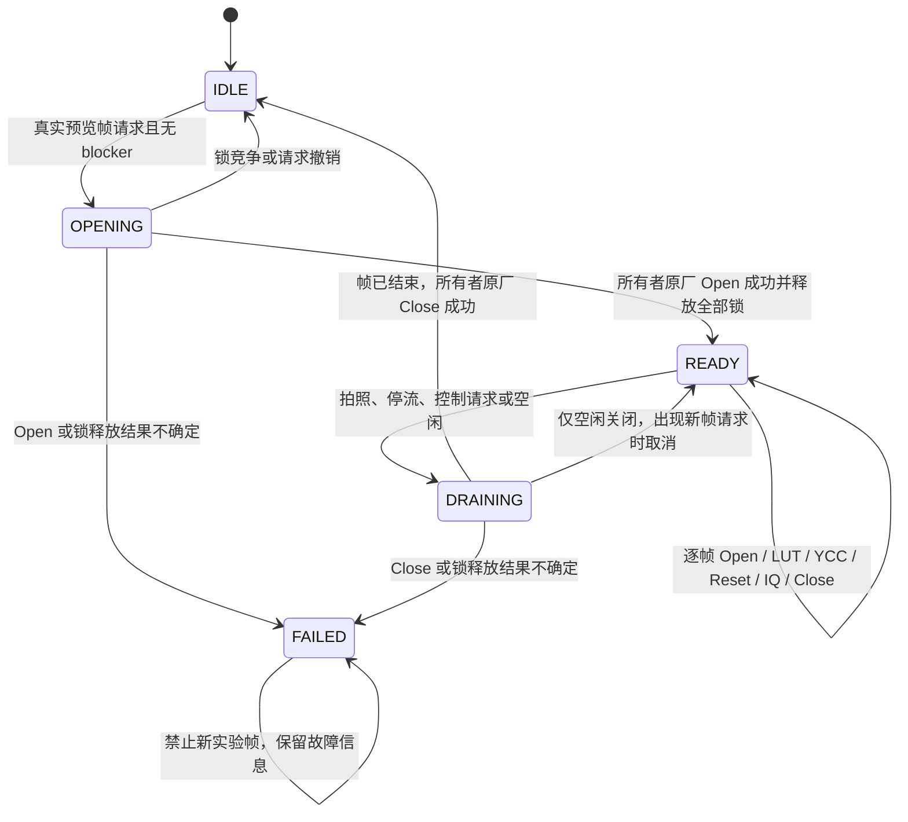

# IPCS Session 复用：实现与验证

更新：2026-11-03。

## Session 稳定性与软件调用开销

当前保持 ABI7 Session 实现，每帧原厂 Open／LUT／YCC／Reset／IQ 恢复／Close 顺序不变。本轮未改动 `ipcs_session.c`、`smartfilter_session.inc` 或 `smartfilter_ipcs.c`，仅增加离线测量夹具。

`tools/probe_ipcs_session_cost_vm.py` 在独立 ARM Linux、原厂 glibc／pthread／UDD 环境中实际运行当前 Session 管理代码。3618 次准入和 96 轮嵌套 capture／stream／control 阻止、排空、恢复后，Open／Close 为 98／98，最终 held=0，五锁全部释放，固定所有者与渲染线程不同。空闲释放及现有七项 Open／Close 失败、在途排空、停流超时检查全部通过。原厂 UDD 另完成 5952 对已有引用的 Open／Close，最终引用为 0，只有所有者首开触发一次设备替身 Open。

Open／Close 失败检查验证的是故障阻断，未实现自愈。失败后 `held=2`、`state=FAILED`，`nx_ips_drain()` 返回 -117，B2Y Open 随之拒绝原厂拍照。当前资源是否释放不确定，不能靠清状态或直接放行拍照恢复。这个异常路径仍待解决；需要相机主进程真正退出才能清除其状态，普通开关机可能恢复 MFW 快照。

本轮复查收紧了汇总条件：必须有成功的执行退出码及完成标记、四组各 31 条唯一测量、每批 64 次调用、完整正值计时、九个指定检查及平衡引用。空数据不再显示通过。已有 124 条批次记录按新条件重新分析通过，没有重跑 VM；复现和审查记录见 `outputs/review/session-fit/review.md`。

以下为每批 64 对调用、31 批的墙钟均摊值，单位微秒；P95／P99 是批次均摊分位数，不是单帧长尾。Reset／IQ 和硬件处理不计入此表。

| 调用范围 | P50 | P95 | P99 |
| --- | ---: | ---: | ---: |
| 原厂已有引用的 Open＋Close | 2.921 | 8.473 | 13.044 |
| Open 诊断包装核心，采样关闭，含 Close | 22.159 | 35.022 | 35.642 |
| 同一包装，采样开启，含 Close | 585.896 | 621.879 | 637.805 |
| READY 准入＋生命周期锁＋帧归还 | 265.087 | 353.530 | 369.946 |

准入对的渲染线程 CPU P50 为 262.764 μs，包含所有者线程的进程 CPU 均摊 P50 为 443.381 μs。事件通知会唤醒所有者，是可见的软件成本；目前没有据此改动同步和唤醒语义。诊断关闭时 `nx_ipct_finish` 仍有一次 TID 查询，记录为已知包装成本，未扩展为运行时优化。

结论是保留现有 Session 复用与原厂恢复流程，日常继续关闭 calltrace／timing。报告为 `outputs/performance/ipcs-session-cost/arm-vm/report.json`；VM 已关闭。实体设备首次上电的 11.66 ms 旧记录与上述软件数值属于不同测量范围。复用后的实体 Open 分位数、76 ms 长尾来源、LCD FPS、休眠覆盖及功耗仍缺新数据。

## Open／Close 失败的按需恢复（2026-11-04）

原厂 `libudd.so.3.1` 反汇编（`outputs/metol/ipcs-lifecycle/udd.asm`）已把 Open／Close 的每个失败分支归类：

- `ipcs_open`（0x4bb78）所有失败分支都在 `ipcs_init`（0x4bc74，唯一写寄存器的步骤）之前返回：设备节点 open 失败（-1）、计数超限（-1）、reg_base 失败（-1，原厂自行调 `d4_udd_close` 清计数）、`ipcs_open_irq` 失败（-1/-2，计数保留）。失败调用从不改写 IPCS 寄存器。
- `ipcs_close`（0x4bdb8）只释放句柄（udd 计数、reg_base ioctl+munmap、irq ioctl、fd），不写寄存器；计数已清零后重试 Close 会以 -1 短路，永远无法补做释放。
- Mod 每帧 restore 的 `api.reset` 就是原厂 `ipcs_init`（`tools/build_smartfilter_preview.py` 的 GOT 表：`api.reset→ipcs_init`），寄存器状态每帧重建。

据此，`runtime/ipcs_session.c` 增加有边界的按需恢复：`FAILED` 且 `held==2`、无 unlock/post 记账错误、无 blocker、有帧在请求（`requested`）且距上次失败 ≥2 秒时，所有者线程先做**一次** `api.close()` 尝试（结果只记 `recovery_closes`，不判定），清 `held/error` 后走正常 opening 路径全新 Open——成功即恢复 READY，失败则回到 FAILED 并计入 `recoveries`；每个故障纪元最多 3 次，超限保持现有阻断，恢复成功后计数清零。信号量 post 失败（`unlock_errors`）、帧记账不一致、`nx_ips_fault`（stop 超时/UNCERTAIN）与 Open 计数饱和仍永久阻断，不恢复。`nx_ips_frame_enter` 的错误路径现在会在恢复预算尚存时标记请求并唤醒所有者；无唤醒、无需求时不重试。

夹具新增/调整场景：`open_failure_demand_retry_capped`（失败后无需求不重试；有需求重试 3 次达限阻断）、`open_failure_recovers_on_demand`（一次 close+全新 open 后恢复 READY，帧仲裁不变）；`close_ref` 允许恢复关闭在未持有通道租约时进行（`held==0` 分支）。`ipcs_session` 状态行新增 `recoveries`／`recovery_closes` 字段。`tools/probe_ipcs_session_vm.py` 调用链接受 `--timeout`（Session 探针执行窗口放宽到 900 秒，其他探针默认仍 360），并在探针 trap 中转储 RAM 夹具 stderr，便于定位 guest 失败。

## 切换后等待拍照才接入预览

ABI6 已实机运行，但用户仍需拍照或进入回放才能使预览接入。日志记录了请求代次领先已处理代次；开启 NC 时尚无 S2 节点。静态分析进一步确认：只调用 `changeState(14)` 没有走完原厂恢复流程。

原厂 1.15 的完整关键分支为：

```text
IPCM 完成回调 → 非阻塞 Capture 消息
  → checkDataChangeToRestart(0x39) → changeState(14)
  → changeProcess → BringDownNode → videoStreamOff(false)
  → notifyFromFrontEnd → changeStopCallbackProcess
  → TearDownNode → CheckMapChange
       false: state=20，等待内存匹配
       true: changeRestartProcess
```

本模块有独立的工作缓冲，不改变原厂布局，所以 `CheckMapChange=false` 是需要覆盖的正常分支。此前模拟把 `changeProcess` 简化为直接建图，漏掉了它。

ABI7 增加停流完成回调的局部 Hook。仅在本模块有待完成的重建、且原厂已进入 state20 时，再向 Capture 控制线程发一次非阻塞唤醒。控制线程在原消息处理返回后调用原厂 `changeMemoryAreaRestartProcess(0)`；该入口先执行 `changeMemoryAreaUserDataandMemeoryAreaMatching()`，匹配后才调用 `changeRestartProcess`。不修改 map-change 字节，不直接强制创建节点。B2Y Open→Prepare 窗口或拍照期间延后恢复，原厂未匹配时保留等待状态。

原厂函数地址：`changeStopCallbackProcess=0x288d7c`、`changeMemoryAreaRestartProcess=0x289a0c`、内存匹配函数 `0x289af0`、`changeRestartProcess=0x288e24`。原始反汇编保存在 `outputs/metol/liveview-refresh/{waiting,memory-resume}.asm`。

运行状态增加 `refresh_pending`、`refresh_state`、`refresh_resumes` 和 `refresh_wakeups`。只有原厂回到运行状态、无下一条待处理动作且实际拓扑符合当前请求，才清除 pending。已有预览节点的风格切换仅更新 LUT；稳定取景不重复重建。

当前 Session 为 ABI7、20 个 GOT 调用点；ABI4 后端另行保留。模拟执行原厂消息派发、真实 stop callback、真实内存匹配和 restart 前缀，设备停流与最终硬件建图仍使用替身。新增检查包括：异步完成后唤醒、未改变布局时恢复、布局不匹配时等待、B2Y 窗口让路、只关闭预览后保留成片 LUT。首次自动接入与切换延迟仍须实体复测。

当前 build 为 `379524489`，RAM 镜像 151,552 字节。`arm-vm/report.json` 已通过上述检查，设备模拟脚本退出 0，VM 已关闭。主菜单导航及 LUT 键盘／触屏选择检查使用同一份 nxui，并分别保存于 `outputs/performance/menu-event-loop/lut-control-menu-final` 和 `lut-selection/menu-final`。汇总脚本曾误引用 Hard Mono 不存在的组合表，修正后对保存输出重新核验通过，原失败记录保留；没有为此重复执行设备模拟。

## 菜单与控制耗时

长按 Custom 恢复正常主菜单；调试集中到「调试与诊断」。主菜单的「关闭取景预览 · 照片保留」调用 `stop`，不改变照片选择和 Still Hook，也不导出计时或 Open 诊断。之后换照片 LUT 不会自动重开预览；需要时从主菜单重新开启。

LUT 列表的「关」继续关闭取景和成片；诊断页的「关闭预览并保存诊断」仍执行完整导出。打开菜单不会自动停止预览。

本轮前的实体日志中，Mono 提交耗时 11.765 s，其中预览同步 11.607 s；全关耗时 15.706 s，预览恢复占 13.707 s。一次完整文件认证为 4.981 s，同进程认证复用约 130 ms。这些是控制路径耗时，不能替代逐帧 ISP 或 LCD FPS。普通关闭省去诊断导出；本轮不更改逐帧 LUT、Reset 或 Still IQ 恢复。

## Session 复用与前轮记录

Session 候选已完成构建和 ARM／MFW 用户态模拟验证。它用固定线程成对调用原厂 `ipcs_open`／`ipcs_close`，在连续预览之间保留一个真实引用，同时保留每帧原有的 Open／Close、LUT 写表、YCC 处理、Reset 与 Still IQ 恢复。

**本轮上机包默认开启 Session 引用复用，正常预览关闭逐帧计时和 Open 采样。** `IPCS_SESSION_PREVIEW=1` 将普通预览、黑白预览和风格同步接到 Session=1；固定所有者管理额外引用，每帧仍执行原厂 Open／Close、Reset 与参数恢复。模拟器负责原版与复用版的切换和故障检查，机身直接使用复用版。

用户已实机反馈独立黑白预览流畅。「当前 LUT」没有黑白的日志则显示首次调用加载了 `stock`，随后 LUT 面板报 `verified RAM SmartFilter sync unavailable`。现已修复两处选择传递：普通入口先用现有引擎恢复保存的选择；面板同步通过 `NX300M_MFW_RAM_BASE` 找回 RAM 服务及其状态目录，不再把 SD 数据目录、面板私有状态当作服务目录。同步只在选择变化时执行，像素处理与 Session 镜像未改。

最近成功取得的实体 Open 窗口来自11月3日 11:27，属于修改前的 Session=0：64 次有效实机 Open，64/64 进入 UDD 首引用分支。Open P50/P95/最大值为 11.709/11.971/14.830 ms，设备 Open P50 为 10.630 ms；外层 mutex 最大值为 2 µs，本窗口没有复现之前的 76 ms。12:01 未取得成功的 KDD 窗口。新版本的实体 Open 耗时、LCD FPS 和功耗尚未取得。

前一窗口的 61 次首引用、两次 27/31 µs 复用快路径和一次 12.431 ms mutex 等待仍保留在原始日志中，不能与本次 64 条记录合并。最新分析结果来自最后一个完整导出窗口。

专用测试卡 H: 使用独立 ABI5 文件，机身预览入口统一启用复用。Session=0 的采样命令保留给开发维护，机身菜单不提供版本对照入口。原 ABI4 loader/blob 和 LUT 目录保持原位。操作见 [IPCS_DIAGNOSTIC_CARD.md](IPCS_DIAGNOSTIC_CARD.md)，部署工具为 `tools/prepare_ipcs_diagnostic_card.py --deploy`。

本轮已写入 H:（FAT32，序列号 `LOCAL_REDACTED`），14 个目标文件回读一致、9 个变更，1,193 个无关文件的清单与元数据未变。报告：`outputs/deployment/smartfilter-session/diagnostic-card/reader/card-LOCAL_REDACTED/ipcs-open-20261103T050821Z/report.json`；其中 `session_mode=1`、`diagnostics_enabled_by_default=false`。

随后追加当前 LUT 同步和面板空转修复，最新部署报告为 `ipcs-open-20261103T054307Z/report.json`：16 个目标文件回读一致、5 个变更，1,195 个无关文件元数据未变。Session RAM 镜像与原版后端未覆盖，更新了选择引擎、nxui 和启动脚本。拍照保存本轮尚无实机编码／写卡分段时间，现有卡上日志不能计算整次保存耗时。

首次诊断的 rc=3 已定位为 libudd 的 `open()` GOT 解析到原厂 libpthread 线程取消封装，而加载器只接受 libc 实现。已核验两种原厂入口，保留实际解析目标，并通过加载、再次应用、查询及软停的 ARM/MFW 回归；修正版随后在实机取得了上述 64 条记录。

实机原始日志和解析结果位于 `outputs/deployment/smartfilter-session/camera-open-20261103/`。两次导出包含同一组 64 条记录，统计只使用最后一份完整窗口，没有把重复导出计为 128 次调用。

## 1. 修改范围与产物

| 部分 | 文件与职责 |
|---|---|
| 生命周期核心 | `runtime/ipcs_session.c`、`.h`：所有者线程、引用状态、排空、空闲释放 |
| 原厂适配 | `runtime/smartfilter_session.inc`：B2Y Open／Close、LiveView Stop／Start、生命周期信号量 |
| 逐调用计时 | `runtime/ipcs_calltrace.c`、`.h`：有限窗口、wall／thread CPU、原厂 UDD 返回分支 |
| 安装与切换 | `runtime/smartfilter_loader.c`：先恢复目标运行以排空，再提交配置；诊断导出 |
| 候选构建 | `tools/build_smartfilter_preview.py --session`：单独 ABI5 镜像与 17 个 GOT 调用点 |
| 静态调用点 | `tools/inspect_ipcs_session.py`：原厂锁顺序、Open／Close 及 LiveView 直接调用者 |
| ARM 验证 | `tools/probe_ipcs_session_vm.py`：实际 RAM loader、MFW 库、故障与引用分支验证 |

原像素事务实现 `runtime/smartfilter_ipcs.c` 没有修改。Session 没有增加硬件寄存器快照缓存。

```powershell
python -X utf8 tools/build_smartfilter_preview.py --session
python -X utf8 tools/probe_ipcs_session_vm.py
```

候选目录：`outputs/deployment/smartfilter-session/`；ABI5，17 个调用点，RAM 镜像 151,552 字节，build `2856811021`。

原 ABI4／7 调用点后端保留在 `outputs/deployment/smartfilter-preview/`，build `3024681160`。其 loader 与 RAM 镜像在本轮前后哈希一致；当前 ABI4 源码也已单独编译到候选目录中的 `baseline-build/`，没有覆盖原产物。见 `baseline-preservation.json`。

ABI4／ABI5 的配置、状态和 loader 必须匹配；本实现不替换已经驻留的另一 ABI。诊断卡通过 `IPCS_OPEN_DIAGNOSTIC` 标记选择独立的 ABI5 文件，旧 ABI4 二进制保留在原位置。

## 2. 逐调用证据：已经能记录什么

`--calltrace 1` 开启一个最多 64 次 Open 的窗口，最多同时跟踪四个线程。每次调用保存序号、TID、预览／Session 角色、帧序号、起止时间、返回值及以下阶段：

| 阶段 | 实际拦截位置 |
|---|---|
| total | 预览或所有者调用原厂 `ipcs_open` 的外层 |
| outer_mutex | UDD IPCS 外层 mutex |
| udd_mutex | UDD 设备 6 的 mutex |
| udd_open | 原样转发 `d4_udd_open`，保存其真实返回值 |
| device_open | UDD 内调用 libc `open` |
| regmap | `ipcs_open_reg_base` |
| irq | `ipcs_open_irq` |
| init | Open 内部 `ipcs_init` |

每段同时读取 `CLOCK_MONOTONIC` 与 `CLOCK_THREAD_CPUTIME_ID`。计时和固定内存记录发生在调用内；导出和统计发生在调用外。未扣除计时器及 Hook 自身开销。

UDD 的返回 0／1 分别对应**本进程首引用／已有引用**；Open 外层成功返回均为 0，不能用于区分。计数前后读数只作为 snapshot。原厂 UDD fixture 已实际执行 `ipcs_open`、`d4_udd_open` 和 `ipcs_close`，捕获到 `first → existing → first`，并确认首开的所有者 TID 与逐帧调用 TID 不同。

**这仍不是 KDD 首次上电证据。** UDD 为本进程首开时，其他进程可能已经持有设备。所有导出中的 `kdd_transition` 均为 `null`；分析器不会从 UDD 或耗时反推 KDD。

`open-export` 输出分行 NDJSON，包含调用记录及 ptrace 控制区间。`tools/analyze_ipcs_calls.py` 排除未提交记录、时钟无效、控制区间缺失及暂停区间重叠，并区分嵌套段，避免重复相加 UDD 与其内部 mutex／设备 Open。`wall − thread CPU` 仅表示非本线程 CPU 的 wall 时间，不能直接命名为锁等待。

```powershell
python -X utf8 tools/analyze_ipcs_calls.py <open-export.ndjson> --output <report.json>
```

诊断版的 `--session 0 --calltrace 1` 保留逐帧首开行为，适合先定位分支。它仍是 RAM 诊断 Hook，不是纯 procfs 只读观察器。`tools/ipcs_trace_preflight.sh` 只读检查实际内核的 tracing 能力；不挂载 debugfs、不改变 tracing 控制。

### 实机诊断尚缺

必须在同一 TID、同一 Open 起止区间内，补上 KDD 引用变化及 PMU／DMA reset 事件。已在实际 1.15 内核核验原厂 `/dev/d4_opener` 的只读 GET_PID_LIST：命令 `0x4198620d`，408 字节，返回设备引用及 100 项持有者列表，查询时取得 KDD mutex；该设备的 Open／Release 为直接返回 0。证据见 `outputs/metol/ipcs-lifecycle/opener-interface.asm` 和 `report.json` 的 `kernel.opener_read_only`。

新增 `runtime/ipcs_kdd_probe.h`，由 loader 的 `kdd-probe` 命令执行。后台任务在预览首次记录后，以 PTRACE_SYSCALL 短时观察同一取景线程，对实际设备 Open／Close 的入口及出口读取原厂 KDD 快照，最多三对调用、约两秒后脱离。不注入调用，不写寄存器、目标内存或引用计数。该取景线程的 syscall stops 会扰动时间，因此整个观察区间加入现有控制 ledger，从正常 Open 分位数中排除。

12:01 实机日志已找到取景线程 `tid=1310`，首帧等待 11,420 ms；随后窗口为 `detached=true,error=4,steps=0,stage=observation_cancelled`，仍无 `ipcs_kdd_call`。旧的两进程实现先等待首帧，再启动观察器重新校验整份相机程序及六份库；第二次校验期间触发 15 秒 watchdog，尚未 attach 就被取消。外层启动器也超时，留下不确定操作标记，导致后台软停失败。该轮面板还记录到 `max_draw_ms=3949`；这些日志能证明控制流程失败，不能分离出每项开销对 LCD 卡顿的贡献。

现在一个 `kdd-probe` 进程完成认证、首帧等待和短采样。完整文件校验只做一次，文件句柄保留至观察结束；首帧之后复查文件身份、进程寿命、映射、驻留配置和代码指纹，不再重复整库 SHA。首帧最多等 60 秒，期间不持有控制、预览或媒体 lease，也不 attach。软停或切换 generation 会取消等待。首帧后才短暂取得三类 lease，按 PID/start/build/window/generation token 验证，再观察最多三对设备调用。输出新增 `preflight_ms` 与 `identity_reused`，用于核查前置开销。

仅该 KDD 命令使用分阶段长预算：loader 为 85 秒，外层已验证的启动器为 90 秒；观察本身仍约两秒。普通控制命令的预算不变。watchdog 请求取消后等待确认退出和 detach，不将已确认结束的只读观察误标为未解决。

旧标记只在 restore 时按确切证据恢复：对应控制进程已退出、相机 start 未变、所有线程无 tracer／停止态，且该控制进程专属日志证明观察在 attach 前取消（steps=0、begin/end 均零）。通过后在 `/tmp` 原子重命名归档，再正常软停；`/tmp` 与 `/var/run` 可以是不同挂载点，因此不跨目录 rename。未知标记、已经修改目标或不能证明脱离的操作仍保留。

`ipcs_kdd_call.before/after` 是逐调用前后的真实计数与持有者快照；它们不是内核分支探针，不单独证明 PMU 内部哪一步执行。`kernel_branch_probed` 保持 false。实体接口和实际 KDD 数据仍待本轮上机，不用 ARM fixture 的零计数作为硬件证据。

76 ms 长尾先按八段定位；若发生在设备 Open，再联合 KDD、PMU／Clock、sched／IRQ 区分实际忙等、阻塞、可运行未调度和中断贡献。当前 64 次窗口未复现 76 ms，不能把本次 mutex 等待当成旧长尾的已确认根因。

## 3. 原厂生命周期与锁顺序

静态调用证据在 `outputs/metol/ipcs-lifecycle/session-sites.{asm,json}`：

- B2Y Open `0x14ba84`：在 `0x14bafc` 取得实例 `+0x44`，随后 `0x14bb00` 调 `ipcs_open`。
- B2Y Close `0x14bb2c`：先 `0x14bb54` 调 Close，最后 `0x14bbc0` 释放 `+0x44`。
- 无参 `GetSemaphore()` `0x14bbdc` 返回 `this+0x44`。它与四个按 ID 取得的通道信号量不同。
- `CLiveview::stopProcess` 为 `0x288944`；`Start(int,unsigned)` 为 `0x285fec`，返回 bool，1 表示成功。

已扫描的直接调用者中，尚未找到可以直接借用的普通 LiveView 常驻 IPCS 引用。当前候选因此使用独立所有者；这不证明整个原厂程序都不存在可借用生命周期。

本模块顺序为：

```text
关闭新帧准入 → 排空已有帧
  → 所有者 trywait(+0x44)
  → trywait(通道 0 → 1 → 2 → 3)
  → 原厂 Open 或 Close
  → 逆序释放通道 → 释放 +0x44
```

任一 trywait 竞争时立即释放已取得的锁，稍后重试所有者事务。逐帧事务也先短暂取得 `+0x44`，再进入原有四锁处理链。**Session READY 状态的帧间没有持有这五把锁。** 引用用于延续设备生命周期，不代表独占操作资源。

拍照必须在 B2Y **Open 之前**阻新帧、排空并归还额外引用，再进入原厂 Open；到 Prepare 才等待 `+0x44` 已经太晚，会构成锁顺序风险。Prepare 适配层只检查此条件，不在这里等待生命周期锁。

四个通道锁加 `+0x44` 覆盖当前预览与 B2Y 适配路径。ADE、FD、mm-photo、sif 等独立调用者，以及间接调用、跨进程 IRQ callback／参数覆盖尚未逐项完成实体验证；这部分不属于已通过的模拟器结果。

## 4. 资源状态机



`held=0/1/2` 是本模块的“无引用／已持有／结果不确定”，不映射或改写 UDD／KDD count。

所有者用原厂 pthread API 创建，栈 64 KiB；额外 Open 和 Close 始终由同一 TID 执行。首帧请求只唤醒所有者，引用就绪前的帧直通。没有引用或处于终端故障时使用 futex 事件等待；不会在关闭预览后持续轮询。

连续取景的帧间保留引用。最后一帧**完成**后约 250 ms 没有新需求会归还，不把耗时较长的在途帧当成空闲。空闲 Close 前重新检查新请求，避免不必要关电。

拍照 blocker 从 B2Y Open 前保持至对应原厂 Close 后。已拒绝的 Open 单独计数，其对应 Close 不调用原厂 Close，不会多 post `+0x44`。嵌套 blocker 使用计数，不能由一次释放全部清除。

停流在原厂 `stopProcess` 前 drain，原厂 Start 成功后才解除 stream blocker；等待后续真实帧请求才重新开 Session。drain 的 750 ms 超时或不确定分支会保持准入关闭并返回，不进入原厂 `BringDownNode`／`videoStreamOff`。在途帧完成后，健康引用仍由所有者释放；不把超时返回当作停流成功。

已找到的两个原厂 Stop 调用点（`0x28827c`、`0x28889c`）均不读取 Stop 返回值。因此 Hook 拒绝清理并不证明上层模式切换已经取消；该故障状态的实体交互仍待验证。休眠和各模式是否全部经过这些停流入口，同样需要调用覆盖确认。

控制切换先设置准入暂停，再 detach，让所有者正常运行和 Close；不能停止全部线程后等它释放。排空成功才提交配置或回退。所有者等待时执行原厂 libc syscall，避免线程永久停留在注入代码区而无法完成后续控制事务。

## 5. ARM／MFW 验证结果

本轮 `tools/probe_ipcs_session_vm.py` 退出 0，ARM 探针输出 `SMARTFILTER_ARM_BOUNDARY_PASSED`。汇总器分别处理各导出窗口，最终 `arm-vm/report.json` 为 `passed: true`，私有 VM 已关闭。

模拟环境使用实际 MFW 用户态库、原厂 SmartFilter worker、实际 RAM loader 与 17 个 GOT Hook；内核是 generic ARM Linux。物理 `/dev/d4_ipcs`、PMU、DMA、寄存器及像素处理是明确替身。以下结果验证控制流和资源管理，不测量实体 ISP 性能或真实色彩。

| 验证 | 结果 |
|---|---|
| Session 关闭→开启→关闭 | 三组参考像素字节一致 |
| 连续八帧 | 保留一个额外引用；每帧仍 Open／Close；设备替身不重复首开 |
| 帧间锁 | 四通道与 `+0x44` 的值均恢复 1 |
| B2Y 拍照 | 原厂 Open 前已排空并释放 Session；Close 后可恢复预览 |
| 通道竞争 | 非阻塞退出，临时生命周期锁已归还 |
| 空闲与软停 | 引用归零 |
| Open 失败 | 不循环重试，不伪造“未持有” |
| Close 失败 | 进入 FAILED，`held=2`，不反复 Close |
| 帧在途 drain | 先超时；帧退出后可完成，不提前释放 |
| 渲染故障 | 阻止新实验帧，健康引用由所有者释放 |
| 控制事务 | 先恢复目标运行以排空，之后提交 |
| stream stop／resume | 停流归还、恢复后按真实帧需求重新请求 |
| 停流 drain 超时 | 保留 stream blocker；不提前 Close 在途帧引用；帧结束后健康引用归还 |
| Stop／Start 适配器 | 正常 drain 后才调用原厂终端回调替身；不确定 drain 不调用 Stop 回调 |
| 已拒 Open 的后续 Close | 不多释放 `+0x44` |
| 不确定 Close 后 restore | 返回 3，准入保持暂停；不宣称已恢复 baseline，帧可直通 |
| 原厂 UDD 函数 | 实际执行首开→已有引用→首开；所有者与逐帧 TID 不同 |
| 首帧延迟 | 取景空窗超过旧三秒预算后才生成帧；约 5.5 秒就绪，成功采三对 Open／Close 并脱离 |
| 首帧前的锁 | 等待期间可独立取得预览、控制及媒体独占锁 |
| 首帧前软停 | 正常取消对应 generation；未 attach、无 uncertainty guard，TracerPid 为 0 |
| 认证复用 | 同一观察进程保留已认证文件句柄，首帧后不重复整库 SHA |
| 旧只读超时标记 | 有对应的 attach 前取消记录时可归档并软停；没有证明时拒绝恢复 |
| 首次开启当前 LUT | Still 适配器未加载时，从卡上保存选择恢复黑白；输出与独立黑白入口相同 |
| 面板环境同步 | SD 数据根和私有 UI 状态环境下，仍能同步到真实 RAM 服务；风格和 37% 强度均正确 |
| 明确选择原样 | 预览恢复原样，随后开启当前 LUT 不复活旧的保存风格 |

本轮增加实际部署脚本及选择引擎检查：读取 Session 标记、恢复保存风格、关闭计时与调用采样，连续帧复用引用，面板切换同步、拍照排空后恢复，最后软停归还引用。整合 fixture 的 Open／Close 为 76／76，设备替身为 13／13，最终 held=0。维护诊断入口仍使用 Session=0，完整窗口写入模拟卡日志后由分析器读取。七项独立故障／排空场景中，返回错误且引用仍保留的情况按“不确定”状态记录，不计作已恢复。

这里的三段切换是在**同一个 ABI5 镜像中切换 `session=0/1/0`**。原 ABI4 产物另行保全；本次没有用模拟像素结果宣称两个 ABI 在所有真实设备状态下等价。

原始证据：

- `outputs/deployment/smartfilter-session/arm-vm/report.json`
- `arm-vm/guest/mfw-results/session-failures.ndjson`
- `arm-vm/guest/mfw-results/{baseline,candidate,return-baseline}.yuv`
- `arm-vm/guest/mfw-results/udd-calltrace.ndjson` 与 `arm-vm/udd-calltrace-report.json`
- `arm-vm/guest/mfw-results/{candidate-trace,uncertain-trace,uncertain-status}.json`
- `arm-vm/candidate-calltrace-report.json`：导出完整解析；整合 fixture 替换了 UDD，所以分支正确标为 unverified，时间不得当作实机加速数据。

## 6. 已有实体性能记录

已取得的实体 baseline 来自原 ABI4 的 119 帧，不是本轮新测。nearest-rank 分位数：

| 原版实体耗时（ms） | P50 | P95 | P99 | 最大值 |
|---|---:|---:|---:|---:|
| 预览事务 | 19.583 | 21.723 | 28.640 | 84.010 |
| Open | 11.659 | 11.932 | 15.027 | 76.163 |
| Close | 0.136 | 0.191 | 0.287 | 9.351 |

原窗口 dropped=23,968。仅凭这 119 帧不能代表完整长时间分布。静态已证明首次上电含约 10 ms DMA reset 忙等；只有实机确认该分支反复发生后，才能把避免频繁上电作为有根据的收益预期。不能用 `1000 / 预览处理时间` 代替 LCD 有效 FPS。

最新实体 Open 分段来自 11月3日回收的测试卡日志。上机包已经切换为复用配置，尚无该配置的实体耗时、LCD FPS 或功耗数据；模拟器时间不代表 ISP 性能。

## 7. 上机使用与剩余验证

开机后选择 LUT，再长按 Custom，选择「开启取景预览 · 当前 LUT」，退出面板使用。只关闭取景时选择「关闭取景预览 · 照片保留」；保存诊断在「调试与诊断」中。不要求机身切换原版或执行对照流程。

原版／复用版切换、锁竞争和 Open／Close 失败注入留在模拟器。机身只需检查正常取景、拍照后恢复预览、软停和模式切换。实体 LCD 呈现、传感器拍照、休眠和功耗无法由当前 ARM 模拟器验证；出现异常时保留卡上 `logs/fn-key.log`，由开发端读取。

## 8. 恢复语义

正常关闭 Session：阻新帧 → 排空 → 所有者 Close → 确认无额外引用 → 恢复 `session=0`。正常软停另外恢复原厂 GOT 调用点。

不确定 Open／Close：停止新实验帧，保留故障和已发布 RAM，`restore` 返回错误；不能篡改原厂 count、强行 post 锁或反复 Close。此时帧直通不等于设备资源已恢复。

已发布的 RAM 映射和休眠的所有者线程保留至相机进程退出，防止原厂调用栈中的返回地址失效。不能在仍有引用或回调时 munmap。跨 ABI 回退需要确认相机进程真正退出；普通关机若走 MFW 快照恢复，不能据此假定旧进程与引用消失。

当前交付为默认开启 Session 复用的上机包、逐调用维护诊断及 ARM 故障验证。实体 KDD 证据、76 ms 动态归因、全部客户仲裁，以及新版本实体耗时／LCD／功耗仍待取得。
